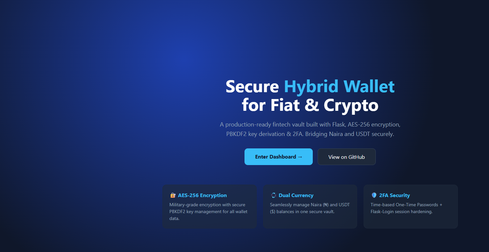
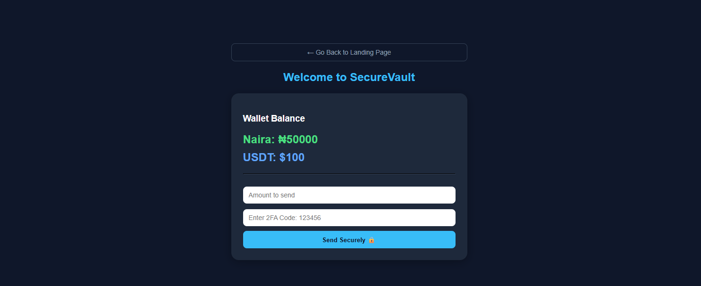
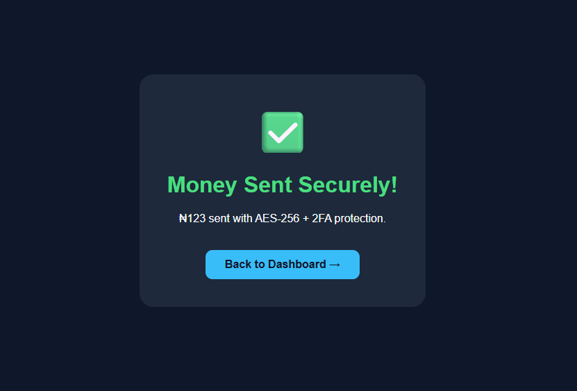

# SecureVault - Secure Hybrid Wallet for Nigeria

A secure money transfer system built with Python Flask, AES-256 encryption and 2FA.

**Stack:** Python, Flask, Fernet, HTML/CSS, MVC





## Problem Solved

Nigerians face high fees and insecurity in cross-border payments. SecureVault provides a single secure interface for local (NGN) and crypto (USDT) transactions with end-to-end encryption.

## Features

- Secure login with session management
- Dual balance system: Naira & USDT
- Encrypted fund transfer with cryptography
- Dashboard with real-time balance tracking
- Secure transaction history

## Tech Stack

- **Backend:** Python, Flask
- **Security:** Cryptography (Fernet), Hashing
- **Frontend:** HTML, CSS (Flask Templates)
- **Architecture:** MVC pattern

## How to Run Locally

```bash
# Clone the repo
git clone https://github.com/Aoamos/SecureVault.git
cd SecureVault

# Create virtual environment
python -m venv .venv
.venv\Scripts\activate  # Windows
# source .venv/bin/activate  # Mac/Linux

# Install dependencies
pip install flask cryptography requests

# Run app
python app.py
```
